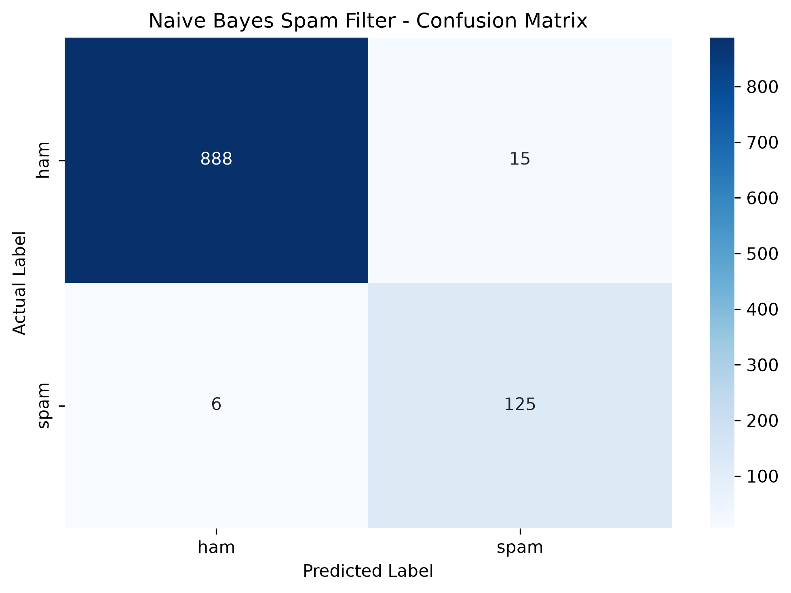

# Naive Bayes Spam Filter from Scratch

A Python machine learning project that classifies SMS messages as **Spam** or **Ham (Not Spam)** using a Multinomial Naive Bayes classifier implemented from scratch.

This project explores text preprocessing, vocabulary construction, probability estimation, Laplace smoothing, model evaluation, and interactive message classification.

## 1. Problem Statement

Spam messages may contain unsolicited advertisements, misleading prize notifications, or fraudulent offers. Manually identifying unwanted messages is inefficient.

This project aims to develop a text classification system that learns from labeled SMS messages and predicts whether a previously unseen message is spam or legitimate.

## 2. Project Objectives

- Implement Naive Bayes classification without a ready-made ML classifier.
- Understand Bayes' theorem and conditional probabilities.
- Convert text into word-based numerical features.
- Apply Laplace smoothing to handle unseen words.
- Evaluate predictions using accuracy, precision, recall, F1-score, and a confusion matrix.
- Identify words statistically associated with spam.
- Build an interactive terminal application for testing messages.

## 3. Technologies

- Python
- Pandas
- NumPy
- scikit-learn — data splitting and evaluation metrics only
- Matplotlib and Seaborn — confusion matrix visualization
- Python `re`, `math`, and `collections` modules
- Git and GitHub

## 4. Dataset

**Dataset:** UCI SMS Spam Collection

Source: https://archive.ics.uci.edu/dataset/228/sms+spam+collection

Messages have one of two labels:

- `ham` — legitimate messages
- `spam` — unwanted messages

After removing exact duplicate label/message rows, the working dataset contains 5,169 unique labeled messages.

| Category | Number of messages |
|---|---:|
| Ham | 4,516 |
| Spam | 653 |
| Total | 5,169 |

The dataset is split into 80% training data and 20% test data using stratified sampling and a fixed random seed.

## 5. Workflow

1. Load the labeled SMS dataset.
2. Remove exact duplicate rows.
3. Tokenize messages into lowercase words.
4. Build a vocabulary using training messages.
5. Calculate class priors and class-specific word counts.
6. Estimate word probabilities using Laplace smoothing.
7. Predict classes using log-probability scores.
8. Evaluate the model on held-out test data.
9. Rank words by their statistical association with spam or ham.

## 6. Algorithm

The project uses Multinomial Naive Bayes.

Bayes' theorem:

P(C | M) = P(M | C) P(C) / P(M)

Here, C represents a class (spam or ham), and M represents a message. P(C) is the class prior, while P(M | C) represents the message likelihood under that class.

The implementation uses word counts with Laplace smoothing:

P(w | C) = (count(w, C) + α) / (totalWords(C) + α|V|)

Where α = 1 and |V| is the vocabulary size.

Log probabilities are used to avoid numerical underflow when combining many small probabilities.

## 7. Project Structure

```text
naive-bayes-spam-filter/
├── data/
│   └── SMSSpamCollection
├── results/
│   ├── confusion_matrix.png
│   └── evaluation_results.txt
├── tests/
│   └── test_classifier.py
├── naive_bayes.py
├── vectorizer.py
├── prepare_data.py
├── train.py
├── app_terminal.py
├── test_naive_bayes.py
├── test_vectorizer.py
├── requirements.txt
└── README.md
```

## 8. Installation

### Requirements

- Python 3.10 or a compatible newer version
- pip
- Git (optional)

### Create a virtual environment

Windows PowerShell:

```powershell
python -m venv .venv
.\.venv\Scripts\Activate.ps1
```

### Install dependencies

```powershell
python -m pip install -r requirements.txt
```

Place the dataset at `data/SMSSpamCollection`.

## 9. Running the Project

### Train and evaluate

```powershell
python train.py
```

This prints the evaluation metrics, confusion matrix, classification report, and word-association analysis. Evaluation artifacts are saved in the `results/` directory.

### Launch the terminal detector

```powershell
python app_terminal.py
```

Enter a message when prompted. Type `exit` to quit.

### Run the unit tests

```powershell
python -m unittest discover -s tests -v
```

## 10. Evaluation Results

The model was evaluated on 1,034 held-out messages.

| Metric | Result |
|---|---:|
| Accuracy | 97.97% |
| Spam precision | 89.29% |
| Spam recall | 95.42% |
| Spam F1-score | 92.25% |

### Confusion Matrix



| Actual / Predicted | Ham | Spam |
|---|---:|---:|
| Ham | 888 | 15 |
| Spam | 6 | 125 |

The model correctly classified 888 legitimate messages and detected 125 spam messages. It incorrectly flagged 15 legitimate messages and missed 6 spam messages.

## 11. Words Associated with Spam

The project ranks words using a smoothed log-likelihood ratio:

log(P(w | spam) / P(w | ham))

Some of the strongest spam-associated words in the training data were:

- claim
- prize
- 150p
- guaranteed
- ringtone
- awarded

These associations depend on the dataset and are not definitive rules for classifying individual messages.

## 12. Testing

Four automated unit tests currently cover:

- Spam classification on a controlled example.
- Ham classification on a controlled example.
- Messages containing unseen words.
- Empty messages.

All four tests passed in the development environment.

## 13. Limitations

- Word frequencies do not capture the full semantic meaning of a message.
- The conditional independence assumption of Naive Bayes is often unrealistic for natural language.
- Performance may vary across datasets, languages, and newer spam campaigns.
- Word-association scores do not prove that a message is spam.
- Sender details, URLs, and other contextual features are not currently used.

## 14. Future Improvements

- Build a Streamlit web interface.
- Add URL and suspicious-link analysis.
- Compare the custom implementation with a library-based baseline.
- Evaluate the model on additional datasets.
- Improve tokenization and investigate duplicate message text across data splits.
- Add model serialization and a reusable prediction service.

## 15. Learning Outcomes

This project provides practical experience with:

- Bayes' theorem and conditional probability.
- Text preprocessing and bag-of-words features.
- Vocabulary construction and word-frequency counting.
- Laplace smoothing and log probabilities.
- Training/test separation and model evaluation.
- Confusion matrix interpretation and unit testing.

## 16. Acknowledgements

Dataset: UCI Machine Learning Repository, SMS Spam Collection.

This project was developed for academic learning to understand the internal workings of a Naive Bayes text classifier.
